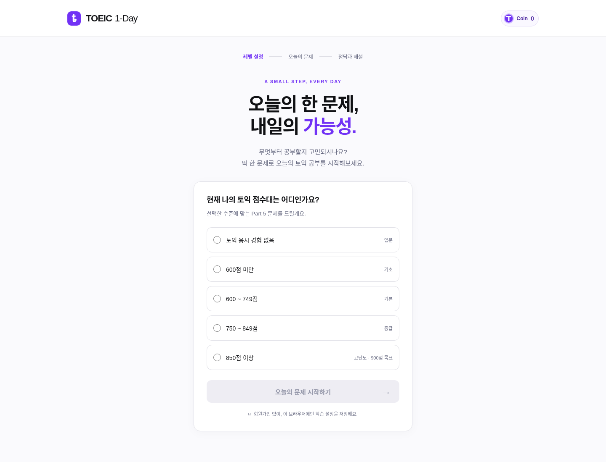

# TOEIC 1-Day

토익 공부를 시작하려는 학습자가 무엇부터 풀지 고민하는 부담을 줄이도록, 수준에 맞는 Part 5 문제를 하루 한 개 풀고 즉시 해설과 T Coin을 얻는 웹서비스입니다.

## 배포 주소

[https://toeicstudyfinal.vercel.app/](https://toeicstudyfinal.vercel.app/)

## 사용 방법

1. 회원가입 없이 현재 토익 점수대에 맞는 레벨을 선택합니다.
2. 오늘의 문제에서 보기 하나를 선택하고 정답과 해설을 확인합니다.
3. 정오답과 관계없이 하루 한 번 T Coin을 받고, 해설에 대한 피드백을 남깁니다.

## 화면



현재 코드의 로컬 실행 화면입니다.

## 만든 과정

- [PRD.md — 제품 요구사항](PRD.md)
- [PLAN.md — 구현 및 검증 과정](PLAN.md)
- [QA.md — 기능별 검증 시나리오](QA.md)

## AI 활용 명세

| 도구 | 활용한 작업 | 제작자가 결정한 사항 |
| --- | --- | --- |
| Codex | Nuxt·TypeScript 앱 구현, README·QA 문서 작성, 문항과 해설 검토 및 수정 | 서비스의 학습 흐름과 기능 범위, 문항 수정의 반영 승인 |
| Codex와 Playwright·Chromium | 레벨 선택·채점·결과 복원·코인 저장의 브라우저 검증, 첫 화면 캡처 | 검증 결과 확인 및 배포 반영 승인 |
| Codex | T Coin 적립 로직과 아이콘 구현, 첨부 Ponytail 스킬에 따른 코드 검토 | 오답도 적립, 하루 한 번만 적립, 레벨 변경 후 코인 유지, 아이콘 모양·문구·정렬 |

제작자가 Vercel 배포와 실제 사이트 확인을 진행하고, 변경 사항을 검토한 뒤 커밋·푸시를 승인했습니다. AI 검증은 실행한 항목에 한정되며, 전체 QA 시나리오의 통과를 의미하지 않습니다.

## 실행

Node.js 22 이상을 사용합니다. 현재 Node.js 24에서 검증합니다.

```sh
npm ci --cache /workspace/.npm-cache
npm run dev
```

```sh
npm run typecheck
npm run generate
```

정적 배포 결과는 `.output/public`입니다. 서버 배포는 `npm run build` 후 `node .output/server/index.mjs`로 실행합니다.

## 데이터와 저장

`app/data/problems.json`에 첨부된 기출 유형 창작 문제를 레벨별 15개씩 총 75개 수록했습니다. 레벨별 문제를 섞어 학습일마다 순서대로 제공하고, 목록을 모두 사용하면 다시 섞습니다. 같은 날 재접속해도 같은 문제가 유지됩니다. 기존에 풀던 문제는 당일 기록 복원을 위해 별도로 보관합니다. 레벨, 당일 결과와 피드백, T Coin은 브라우저 localStorage에 저장합니다. 문제를 제출하면 정답 여부와 관계없이 한국 시간 기준 하루에 코인 1개를 받습니다. 레벨을 바꾸거나 새로고침해도 코인은 유지되지만, 다른 브라우저나 기기에는 공유되지 않으며 사이트 저장 데이터를 삭제하면 사라집니다. 레벨을 바꾸면 이전 레벨의 당일 풀이 결과와 피드백은 삭제됩니다. 잘못된 기록은 무시하며 저장소 접근이 차단되면 안내를 표시하고 코인을 적립하지 않습니다.

## 분석

선택 사항으로 `NUXT_PUBLIC_GA_ID=G-...`를 설정하면 GA4를 로드하고 `level_selected`, `answer_submitted`, `feedback_clicked`를 전송합니다. 측정 ID는 별도로 공급해야 합니다. 기본 상태에서는 외부 전송을 하지 않으며 `toeic:analytics` 브라우저 이벤트로 연동할 수 있습니다. 피드백 내용은 현재 브라우저에 저장됩니다.

## 디자인

`toeic_1_day_mvp_prd.md`와 첨부 DESIGN-kraken.md의 색상 및 컴포넌트 기준을 반영했습니다. 폰트는 설치된 시스템 글꼴을 사용합니다. 독립적인 TOEIC 브랜드로 구성했습니다.
